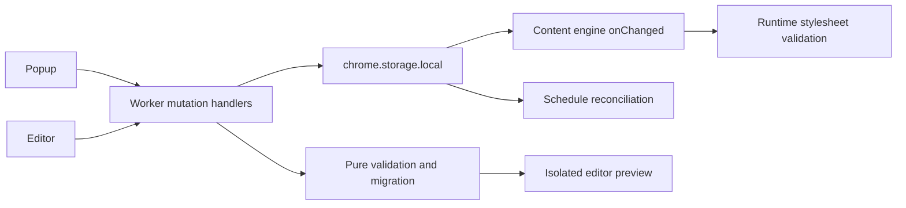

# Cinedrape — Gemini implementation specifications

Version: 1.0 · 14 October 2026 · target: integration-ready local extension.

Read [the implementation audit](IMPLEMENTATION-AUDIT-2026-10-14.md) for observed evidence and limits. These are proposed requirements, not claims of implemented behavior. Existing `docs/ARCHITECTURE.md` remains the repository contract; update it alongside each accepted behavior change. This specification resolves previously ambiguous local-feature behavior for this implementation batch. Keep the product roadmap intact.

## Scope and invariants

Deliver reliable F7 editor, F8 local profiles/scheduling, and F9 file transfer, integrated with F1–F6 and the existing live/text-scale extensions. Retain Windows/PowerShell support, plain JavaScript ES modules, JSDoc, node:test, esbuild, jsdom and puppeteer-core. No framework migration or runtime dependencies are required.

Hard constraints:

1. No remote code, eval, new Function, remote fonts, telemetry, accounts or new network service in this batch.
2. Never hide/cover ads or sponsorship disclosures, move/replace YouTube's player, or remove continuation sentinels from layout.
3. All theme CSS passes the existing allow-list/protected-selector validator before injection, including preview CSS.
4. A broken feature fails open; renewal restores stored Pro choices without destroying them.
5. Do not rewrite the user's modified/untracked files wholesale or commit secrets. Inspect current state before edits.
6. Maintain supported Chrome behavior; new APIs must be feature/version gated. Do not assume Chrome 154 is the minimum just because the audit used it.
7. Release builds remain separate from dev/test builds. Do not rotate signing keys, publish, deploy or configure API_BASE during this batch.

## Target architecture



Keep pure decisions in `src/shared`; Chrome operations in injected background managers; DOM/UI wiring in popup/editor; runtime rendering in content modules. Avoid turning service-worker.js into a collection of unrelated storage algorithms: add a focused `src/background/settings-store.js` or equivalent injected manager.

## WP1 — shared storage, identities and mutation boundary

Priority P0; addresses A01/A04/A06. Files: `src/shared/profiles.js`, new `src/shared/collections.js` (or narrowly named equivalents), `src/shared/constants.js`, new background store module, worker handlers, popup/editor mutation callers. Tests: shared collection tests, worker mutation tests, popup/editor failure tests.

### Canonical local records

Preserve the existing settings schema and top-level keys. New collection records use versioned envelopes:

```js
// cd.profiles
{ schema: 1, revision: 0, items: [
  { id: 'prof-example', name: 'Evening', settings: {
    schema: 1, themeId: 'studio', accent: null, density: null,
    animations: true, textScale: null, calm: {}
  } }
] }

// cd.customThemes
{ schema: 1, revision: 0, items: {
  'custom-example': { /* validated normalized theme */ }
} }
```

The specification intentionally retains profiles as an array inside an envelope: UI ordering is meaningful and lookup must explicitly find by ID. Custom themes remain an ID-keyed collection. `revision` is a nonnegative integer, incremented once per successful mutation of that collection. Persist normalized records, never getters/prototype-derived values.

Required pure interfaces (equivalent naming acceptable if documented):

- `normalizeProfiles(raw, {knownThemeIds}) -> {record, issues, changed}`.
- `normalizeCustomThemes(raw, {selectorMap, bundledIds}) -> {record, issues, changed}`.
- `findProfile(record, id) -> profile | null`.
- `resolveProfileSettings(id, record, themeCatalog) -> settings | null`: saved profile lookup first, then bundled-theme defaults for backward compatibility. Do not treat a custom theme ID as a saved profile ID automatically.
- `validateSettingsSnapshot(raw, {knownThemeIds})`: reusable validation of profile settings; whitelist all allowed properties.

Read legacy `cd.profiles` arrays and legacy ID-keyed profile maps. Read legacy `cd.customThemes` ID maps. Migrate idempotently before worker mutations, while popup/engine readers accept both old and new formats during rollout. Unknown future schemas are read-only and produce a recoverable error; do not downgrade them. Ignore/report invalid entries without crashing, preserve the original collection in a bounded extension-local backup before a lossy migration. No migration sends data externally.

### Identity rules

- Bundled launch IDs are reserved; custom save/import cannot use them. Broadcast is also reserved while shipped as a template candidate.
- New local theme IDs use a `custom-` prefix and remain stable once created. A displayed name change does not change an existing ID.
- A fresh draft may derive a readable slug only once, with a collision suffix/unique component. IDs obey theme-schema constraints.
- Import of a bundled ID offers “Import as copy” with a new local ID. No silent overwrite.
- Same custom ID: show existing/incoming names and explicit Replace / Import as copy / Cancel actions. Replacement preserves ID; copy gets a fresh ID.
- Duplicate display names are allowed; references always use ID.
- Changing/deleting a custom theme checks active settings and profile references. Default delete behavior: block with affected profile names and offer explicit reset-to-Cinema plus delete in one mutation. Do not leave dangling references.

### Worker mutation protocol

Add constants to `MSG`; require an extension-page sender for all mutations. Content scripts can retain existing read/status requests but cannot change user collections through these messages.

```js
{ type: MSG.SAVE_THEME, theme, mode: 'create'|'replace',
  expectedRevision, apply: false }
{ type: MSG.DELETE_THEME, id, expectedRevision, resetReferences: false }
{ type: MSG.SAVE_PROFILE, profile, expectedRevision }
{ type: MSG.DELETE_PROFILE, id, expectedRevision }
{ type: MSG.APPLY_PROFILE, id }
{ type: MSG.UPDATE_SCHEDULE, schedule }
// Also route existing settings patches through a validated worker mutation
// when implementing concurrent schedule/manual changes.
```

Success: `{ok:true, revision?, saved?, selected?, record?}`. Failure: `{ok:false, reason, issues?}` with bounded, safe messages; reasons include `forbidden`, `requires-pro`, `invalid`, `conflict`, `limit`, `referenced`, `storage-unavailable`, `map-unavailable` and `unknown-schema`. Never include a licence token in diagnostic output.

Serialize all settings/collection/schedule mutations within the worker. Read the latest collection inside the queue; compare expectedRevision; on conflict return current safe metadata and require UI reload/retry. Since worker state is disposable, storage is authoritative; recreating the worker must retain revisions. Apply save-and-select with one `storage.local.set` containing both keys and send success only after it resolves. This is a serialized multi-key write, not a promise of general database transactions.

Catch Chrome call rejection/timeouts at UI boundaries. Disable pending action buttons, avoid duplicate writes, keep unsaved drafts, and show retry. Worker absence gets the existing bounded reconnect strategy. Do not mutate collection UI as committed until storage confirms success. Settings may remain optimistic only with rollback/reload behavior.

### Acceptance

- A popup-created profile resolves through the worker and applies all settings fields.
- Two editors saving different themes cannot silently lose either theme; same-revision conflicts are surfaced.
- Popup deletion and editor save racing cannot resurrect deleted content without conflict/retry.
- Legacy arrays/maps migrate twice with identical results and no lost valid entry.
- Reserved ID import cannot replace a bundled theme or report the bundled theme as the imported appearance.
- Storage rejection reports failure and preserves the editor draft; no false success or unhandled rejection.
- Limits use `LIMITS.maxProfiles`, `maxCustomThemes`, `maxCustomThemeBytes`; remove duplicated numeric literals in mutation paths.

## WP2 — profiles and scheduling end to end

Priority P0/P1; depends on WP1; addresses A01/A02. Files: profiles helpers, worker/schedule manager, popup profile/schedule view, constants and architecture. Test with injected clocks, verified mock Pro state, real chrome-mock storage and popup-produced records.

### Validation and reference rules

- `enabled` is a Boolean; reject malformed values instead of Boolean-coercing strings.
- Times are valid zero-padded `HH:MM`, different from one another. Equal times are rejected with “Choose different day and night start times.”
- Enabling requires two resolvable profile references. Do not substitute defaults for invalid IDs.
- UI selectors include saved profiles and explicitly labeled bundled-look shortcuts, matching worker resolution behavior.
- Missing/deleted profile: keep current settings, disable the schedule, and surface a persistent recoverable reason; no per-minute failure loop.
- Free/expired/invalid licence suspends scheduling while preserving schedule configuration and profile data. Existing licence renewal restores availability, not lost choices.

Schedule record extends existing fields with `schema:1`, `manualOverrideUntil:null|number` and optional bounded `lastError` status. Reader defaults cover the current unversioned record. Document these fields and do not export timestamps as theme data.

### Time semantics

- Schedule follows the device's local wall clock. State this beside time controls; no timezone selector in this batch.
- Day is `[dayTime, nightTime)`; night is the complement. Support overnight intervals as the current pure function does.
- Reconcile on install/update, browser startup, worker initialization after synchronous listener registration, schedule/profile edits, relevant licence changes and the schedule alarm.
- At each event recompute from current local time; do not replay every missed transition.
- Keep a one-minute periodic alarm for enabled schedules with usable Pro state; clear when disabled/suspended and recreate on eligibility restoration. No content-script interval polling.
- Check immediately at startup/edit/activation; the timer is not the initial apply mechanism.
- DST/local-clock/timezone changes are handled on the next reconciliation by current-time recomputation; no fixed 24-hour millisecond interval assumption.
- A manual theme/setting/profile change while scheduling is on pauses schedule application until the next day/night boundary; show “Manual override until HH:MM” and a Resume schedule action. Store the override deadline so worker restarts preserve it; recompute/reset sensibly if the local timezone changes. Editing or explicitly resuming the schedule clears the override.
- Apply a target only when its normalized effective snapshot differs from current settings; repeated alarms must not generate redundant writes.

The product target remains application within one minute on an awake, normally running browser. Document that alarm delivery can be delayed; after sleep/browser restart apply the currently due profile at the first reconciliation. Do not introduce keepalive hacks to claim an impossible exact guarantee. Reference: [Chrome alarms](https://developer.chrome.com/docs/extensions/reference/api/alarms).

### Acceptance scenarios

1. Popup saves “Day” and “Night”; enable schedule; fire real registered alarm in chrome-mock; verify the stored full snapshot and engine update.
2. Test 07:59/08:00/19:59/20:00, an overnight range, and rejection of equal/invalid times and missing references.
3. Startup at 21:00 applies Night immediately even if last stored settings were Day.
4. Delete a scheduled profile: current appearance persists, schedule disables, UI explains how to repair it.
5. Licence lapses/renews with schedule enabled: suspension/restoration and alarm clearing/recreation behave consistently.
6. Manual override survives worker recreation and ends at the next boundary; Resume applies the currently scheduled look.
7. Serialized simultaneous settings edit and alarm follows the documented override policy without losing unrelated settings.
8. Spoofed content-script schedule mutation is rejected. Storage error returns a safe result and does not claim application.
9. Tests construct local dates or inject a local-time adapter; do not assume a UTC timestamp means the same local hour on every machine.

## WP3 — complete the visual theme editor

Priority P1/P2; depends on WP1; addresses A03/A05/A07/A08. Files: editor model/DOM/CSS/HTML, shared entitlement/validation helpers, background mutation manager and preview fixtures. Preserve existing controls and styling unless a specific defect requires revision.

### Entitlements and state

- Free users may open the editor, preview, and export a valid JSON theme. Save and Save & apply require verified active/grace Pro (F7 policy); show an actionable explanation before a write. F9 import remains usable for free-tier themes as specified in WP4.
- Use the same verified licence helper/fallback behavior as popup; raw claims or a DOM-only disabled button are insufficient. Recheck in the worker mutation boundary.
- Load a chosen saved custom theme through a validated editor URL ID or selection UI. Missing ID gives a recoverable selection view. Bundled templates always start a new copy.
- Maintain `draft`, `original`, `dirty`, `pending`, validation state and stable ID in an explicit model.
- Name editing updates name only for a saved theme. Provide Save as copy for duplication.
- Keep a bounded local draft using a documented extension storage key; debounce writes, recover after reopening, and distinguish draft persistence from saved-theme success.
- Template switch/new/reset with dirty edits requires explicit discard/keep choice. Add undo/redo for field changes (bounded history, e.g. 50 snapshots), and reset to original.
- No-storage environment: preview/export stays available; Save reports unavailable and returns false.

### Shared validation

- Load the bundled verified selector map with the same signing/shape checks used by runtime; optionally use a newer verified cached map. Do not trust the unsigned source JSON for user CSS decisions.
- Validate schema, contrast and CSS against that map. Reuse `validateTheme`, `checkThemeContrast`, `validateCss` and stylesheet builders; do not write a second permissive CSS validator.
- Nonempty CSS with unavailable map cannot be accepted/injected; show a recoverable error. Empty CSS can pass normal schema validation.
- Render all actionable schema errors by field; CSS issues include line/column when available. Contrast report remains visible and save rules follow the existing schema's contrast gates.
- Invalid hex input remains visibly invalid, sets aria-invalid and an error description, and disables successful save until corrected. Never silently save the previous model value while the displayed value is invalid.
- Validate JSON byte limits before persistence/export and enforce allowed paths in model updates; reject `__proto__`, `constructor` and `prototype` segments. Use data-only records.

### Preview contract

- Use isolated extension-local fixture documents/iframe(s), scripts controlled by the extension, and runtime token/stylesheet composition. Do not iframe live youtube.com.
- Preview Home, Watch and Channel using representative fixture markup with synthetic titles/thumbnails, ads/disclosures, player-control placeholders, and continuation placeholders. User CSS cannot style the editor shell.
- Every advertised control has a visible effect in the fixture or clearly states its preview limitation. Home grid/rows/hero-rows, density, watch default/cinema/focus, text tokens, shapes, calm flags and validated custom CSS must be exercised.
- Unsafe CSS is never injected, even while typing; show last valid preview plus current validation errors.
- Honor reduced motion and the draft's motion behavior; no remote preview assets/fonts or history collection.
- Preview widths have documented viewport sizes and overflow behavior. Saved/loaded/exported previews use the same normalized draft.
- Add “Sample preview; verify on YouTube” copy because fixtures do not reproduce all site cohorts.

### Keyboard and screen-reader contract

- Name every picker and hex field; do not rely on adjacent visual labels.
- Use correct tab or radio-group semantics for page/width selection, including arrows, Home/End and a single tab stop per group; preserve visible focus.
- Associate inline errors with fields, announce asynchronous save errors/success once, and focus the first error after failed save.
- At 200% zoom and narrow editor widths, controls and save actions remain reachable with no hidden overflow trap.
- Save & apply means storage selection succeeded; if no connected YouTube tab confirms it, say “Saved and selected; open/reload YouTube to see it.” Do not promise confirmed application from storage alone.

### Acceptance

- Free direct editor navigation cannot persist/apply through a worker save; free preview/export still works.
- Pro creates, reopens, edits, renames and saves one theme without changing its ID or creating duplicates.
- Reopen restores an unsaved draft; discard/reset/undo/redo behavior is deterministic.
- Malicious CSS, invalid hex, low-contrast tokens and oversized JSON show errors and cannot be saved as fully valid.
- Browser snapshots demonstrate layout/density/calm changes and custom CSS effects inside the isolated preview.
- Worker unavailable, storage rejection and revision conflict preserve the draft and show accurate retry states.
- Keyboard-only task: open editor → change each control group → inspect validation → save → reopen theme succeeds.

## WP4 — portable theme import/export and collection management

Priority P1; depends on WP1 and shared validation from WP3; addresses A04/A05/A06. Files: theme-schema transfer helpers, popup handlers/view, worker manager, content engine collection decoder.

### Import

1. Select/paste JSON; check file size before FileReader and UTF-8 size before parsing (64 KiB current limit).
2. Parse supported theme schema; reject unsupported future schemas explicitly; normalize using existing migration behavior.
3. Validate tokens/contrast/layout/calm/CSS with the verified selector map. Show validation summary, tier and name before confirmation.
4. Resolve reserved IDs/collisions using WP1 copy/replace choices.
5. Save through worker manager. Import valid free-tier themes for free users; Pro-tier themes require verified Pro for save/selection. Do not let an imported tier override restrictions on bundled Pro IDs.
6. Optional Apply after import: report saved and selected separately; propagate commit failure rather than unconditional activation success.
7. Clear inputs and close panel only after intended work succeeds. Preserve JSON on failure.

### Export

- Export effective selected theme explicitly or a named saved custom theme. If the user chooses stored/suppressed Pro theme, label it so the source is clear.
- Theme JSON includes normalized theme fields only: no licence token, subscriber claim, settings storage, health data, revision metadata, schedule or browsing data.
- Preserve colors, font enum, shapes, layout, calm defaults and validated CSS so a supported receiving installation with required entitlement gets the same normalized configuration.
- Document that actual font availability and YouTube markup can vary across machines; portable data does not guarantee pixel-identical site cohorts.
- Use sanitized filenames, revoke Blob URLs, and validate before claiming export success.
- Sharing in this batch is a downloaded file. Hosted links/share codes are deferred with no dead UI promises.

### Acceptance

- Round trip on two isolated browser profiles: export → import → compare normalized JSON/configuration and representative fixture screenshots at same viewport/font environment.
- Test reserved IDs, duplicate custom IDs with replace/copy/cancel, malformed/oversized data, unsupported schema, hostile CSS, expired licence, collection limits and quota/storage errors.
- Import error does not close the panel or erase source input. Save-only success is not called activated.
- Delete active/referenced custom theme follows explicit dependency-reset policy and all connected tabs fall back safely.
- Existing runtime CSS gate still rejects hostile CSS when storage is seeded directly outside import.

## WP5 — meaningful release validation and runtime regression protection

Priority P1/P2; depends on WP1–WP4. Files: test helpers, integration tests, existing e2e harness and focused new editor/transfer/schedule browser scenarios. Avoid tests that merely restate implementation or fabricate runtime geometry in jsdom.

### Test matrix

| Dimension | Required cases |
| --- | --- |
| Themes | All six bundled themes + one free and one Pro custom theme |
| Appearance | YouTube light/dark; default/custom accent; motion on/off and OS reduced motion |
| Pages | Home, watch, search, channel, subscriptions, history, playlist, Shorts fallback |
| Watch | Normal, theatre, fullscreen, live and ordinary video; ads/sponsorship placeholders |
| State | Free, active Pro, grace, expired, invalid, worker restart, cold/warm first-paint cache |
| Local features | Editor create/edit/save, import collision, transfer roundtrip, profile alarm application, manual override |
| Resilience | Storage error/conflict, malformed records, missing references, selector rename, newer verified map recovery |

Run complete unit integration, then live browser coverage in bounded batches. Identify logged-out empty states; do not count an empty home as proof of populated hero/rows. Keep synthetic safety fixtures separate from genuine live ad evidence.

### Performance and safety

- Content bundle <150 KiB gzip; retain strict build enforcement.
- Theme switch <150 ms, setting appearance <1 second, added first-paint overhead <50 ms, additional heap <30 MB per tab.
- Compare against an extension-disabled baseline using the same browser/page/viewport, cold and warm caches, with measurement method/sample count declared. Injection timestamp alone is not added first-paint overhead.
- No visible dropped frames in horizontal row scrolling on a representative machine; capture trace plus manual assessment rather than declare zero from jsdom.
- Repeated SPA navigation, theme switching and editor preview changes leave one engine/stylesheet instance, bounded listeners/observers and no accumulating mirrored cards.
- New textScale/live features preserve protected elements, player controls and sponsored labels across theme/layout/calm combinations.
- Logged-in real-ad verification is a release gate when a representative authorized session is available. If no ad is served, mark unverified; do not create evidence by inference.

### Acceptance evidence

Record commands, browser/Node versions, date, profiles, sample sizes, outputs and limitations under `test/e2e/out-<batch>/` and a concise checked-in verification document without personal browsing data. Failures distinguish extension regressions from network/consent/empty-state limitations. No weakening product thresholds to turn a failure green.

## WP6 — reconcile docs and release configuration

Priority P1; depends on implemented behavior and WP5 evidence. Files: README, ARCHITECTURE, STATUS, TASKS, ENHANCEMENT-SPECS, HANDOFF, PRIVACY, release tooling/docs as needed.

- Describe F7–F9 as partial/complete according to acceptance evidence, not file existence.
- Mark older enhancement items implemented only after code and tests establish it; retain historical rationale with clear dates.
- Remove stale known gaps already fixed (grid requirements, install calm defaults); replace with actual unresolved conditions.
- Correct privacy storage key to `cd.selectorMap`; list customThemes/profiles/schedule/draft/backup records and local retention behavior. Match actual alarm purposes and no-network behavior. Avoid unsupported absolute privacy claims.
- Correct key rotation instructions to `npm run keys -- --production`; rotation remains owner-managed and is not performed automatically by Gemini.
- Distinguish mechanical package checks from manual release requirements. A passing strict/package command is not approval for release.
- Local-beta mode can retain `API_BASE=''`: say map repairs arrive through extension updates and licence tokens are locally verified. Remove “a fix is on the way” promises unless there is an operating repair service.
- Future connected services require a separate specification covering endpoint security, manifests/host allow-lists, package guards, disclosures, licensing/device policy and backend tests. Do not simply set API_BASE and weaken permission checks.
- If editor entry is part of released UI, strict build must require its HTML/CSS/JS or gate the entry intentionally; current optional build treatment cannot silently leave a dead editor button.
- Inventory manual release evidence: production-key sentinel, verified bundled map signature, actual artifact contents, privacy/store consistency, live-ad pass or explicit hold, compatibility/performance/accessibility results. Packaging may validate a structured readiness record, but never infer trademark/legal verification from a Boolean placeholder.

## Implementation sequence and completion contract

Recommended batches:

| Batch | Work | Must pass before next batch |
| --- | --- | --- |
| 1 | WP1 collection contracts/migration and mutation queue | Legacy/no-loss, collision, conflict and storage-failure tests |
| 2 | WP2 scheduling | Popup-produced profile integration, lifecycle, entitlement and override tests |
| 3 | WP3 editor + WP4 transfer | Shared validation, identity, roundtrip, failure and browser preview tests |
| 4 | WP5 + WP6 | Full unit/strict checks; browser evidence; docs reflect actual scope |

Before each batch inspect `git status`, read touched modules and existing tests. Preserve unrelated edits. Add a failing boundary regression for the identified defect, implement the smallest coherent fix, then run relevant tests. Full suite/build belong at integration boundaries; avoid repeatedly rebuilding shared dist during other tooling runs.

At completion Gemini must produce:

1. A changed-file list with reasons and mapping from A01–A09 to fixes.
2. A requirement/acceptance table with pass/fail/not-run and evidence paths.
3. Passing `npm test` and `node build.mjs --strict --out dist-verification` after final edits.
4. Browser results and explicit remaining limits, including real ads, performance and lowest supported Chrome.
5. Updated architecture/storage/message contracts, current status and user-facing usage/privacy docs.
6. No unattended publication, key rotation, deployment or API activation.

Completion means integrated behavior and evidence, not merely added modules. If an external browser session or environment prevents a gate, finish all independent work and record the gate as unverified; do not report public-release readiness.
